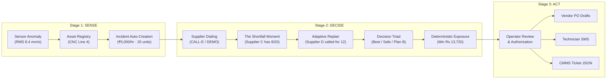

# RestartAI — Autonomous Emergency Production Recovery Agent

> **“We did not find the cheapest supplier. We found the fastest feasible way to restart production.”**

[](https://github.com/your-org/restartai/actions)


---

## 1. Executive Summary

When an industrial machine breaks down, conventional procurement relies on two flawed heuristics:
1. **Cheapest-First**: Sourcing from the cheapest vendor, triggering 18h–26h freight delays and catastrophic downtime costs.
2. **Fastest-Single**: Paying massive express premiums to a single supplier, only to suffer line stoppages when that vendor experiences partial stockouts.

**RestartAI** is a deterministic **Sense $\rightarrow$ Decide $\rightarrow$ Act** autonomous recovery agent. It detects machine stoppage via IoT telemetry, interrogates suppliers across conversational voice/telephony, dynamically arbitrages partial stock shortfalls into multi-leg delivery splits, and prepares a human-gated operational action package before production restart.

---

## 2. Non-Negotiable Invariants

1. **Python-Only Math & Ranking**: The LLM is strictly used for natural language extraction and stakeholder explanation. Arithmetic, financial exposure calculation, technician scheduling, and ranking are 100% deterministic Python.
2. **Human Approval Mandatory**: Autonomous systems must not execute unreviewed financial or physical commitments. "Act" means preparing vendor Purchase Orders, workforce SMS dispatches, and CMMS tickets as drafts. Nothing is purchased or dispatched without explicit operator sign-off.
3. **Deterministic DEMO Default**: Operates completely offline without external credentials, LLM keys, or live telephony. LIVE mode is isolated behind explicit confirmation and E.164 phone validation.
4. **Golden Scenario Invariant**: On `CNC Production Line 4` (Part: `SKF 6205-2RS`, Qty: 20, Max Deadline: 3.0h, Loss: ₹5,000/hr), the engine deterministically outputs:
   - **Recommended Plan**: Supplier C (8 units @ ₹180) + Supplier D (12 units @ ₹190)
   - **Recovery Time**: 2.0 hours (1.5h arrival + 30m install)
   - **Total Purchase Cost**: ₹3,720
   - **Downtime Loss**: ₹10,000
   - **Total Economic Exposure**: **₹13,720** (Optimal, vs ₹16,900 single-source alternative)
5. **Explicit Simulation Labeling**: Any synthetic scenario or benchmark is clearly labeled `SIMULATED SUPPLIER RESPONSES` and `SYNTHETIC BENCHMARK`.

---

## 3. End-to-End Architecture

```text
+---------------------------------------------------------------------------------------------------+
|                                       RESTARTAI ARCHITECTURE                                      |
+---------------------------------------------------------------------------------------------------+

     [STAGE 1: SENSE]                         [STAGE 2: DECIDE]                      [STAGE 3: ACT]
 Industrial IoT Telemetry               Deterministic Uncertainty Planner         Human-in-the-Loop Action
 
  +--------------------+                     +-----------------------+            +-----------------------+
  | SCADA / Vibration  |                     |  Reliability Haircuts |            |  Vendor Purchase      |
  | Sensor (POST /api/ |                     |  & Uncertainty Buffer |            |  Order Drafts (C + D) |
  | events/fault)      |                     +-----------+-----------+            +-----------+-----------+
  +---------+----------+                                 |                                    |
            |                                            v                                    v
            v                                +-----------------------+            +-----------------------+
  +--------------------+                     |    Decision Triad     |            |  Workforce Dispatch   |
  | Asset Registry     |                     | (Best Expected / Safe |            |  SMS (Lead Technician)|
  | (Criticality & KB) |                     | / Fallback Plan B)    |            +-----------+-----------+
  +---------+----------+                     +-----------+-----------+                        |
            |                                            |                                    v
            v                                            v                        +-----------------------+
  +--------------------+                     +-----------------------+            |  Plant Leadership     |
  | Incident Auto-Gen  |                     | Economic Sensitivity  |            |  Executive Brief      |
  | (Machine/Part/Rate)|                     | & Breakeven Curve     |            +-----------+-----------+
  +---------+----------+                     +-----------+-----------+                        |
            |                                            |                                    v
            v                                            v                        +-----------------------+
  +--------------------+   Live Dialogue     +-----------------------+   Human    |  CMMS Work Order JSON |
  | Telephony Service  |===================> | Optimal Plan Ranking  |=========>  |  (SAP PM / IBM Maximo)|
  | (CALL-E or DEMO)   |   Transcripts &     | (Min Total Exposure)  |  Sign-Off  +-----------------------+
  +--------------------+   Confidence        +-----------------------+
```



---

## 4. Empirical Algorithm Benchmark (35 Seeded Incidents)

> [!NOTE]
> **LABEL: SYNTHETIC BENCHMARK**. Simulated across 35 seeded manufacturing breakdown scenarios (CNC lines, injection molders, stamping presses, packaging conveyors, cold headers, SMT placers, extrusion lines) to compare split-sourcing optimization against heuristic defaults.

| Performance Metric | Strategy 1: Cheapest-First | Strategy 2: Fastest-Single | Strategy 3: RestartAI (Adaptive Split) |
| :--- | :---: | :---: | :---: |
| **On-Time Recovery Rate** | **0.0%** (0/35) | **60.0%** (21/35) | **80.0%** (28/35) |
| **Deadline Breaches** | 35 breaches (100%) | 14 breaches (40%) | **7 breaches (20%)** |
| **Average Production Downtime** | 22.60 hours | 4.53 hours | **2.34 hours** |
| **Average Purchase Outlay** | **₹4,108.15** | ₹6,220.09 | ₹5,164.56 |
| **Average Total Economic Exposure** | ₹144,158.91 | ₹34,047.06 | **₹19,467.25** |
| **Financial Savings vs Baseline** | Baseline | ₹110,111.85 (76.4%) | **₹124,691.66 (86.5%)** |

### Counterfactual Procurement Explainer (The Golden Scenario)

```text
+------------------------------------------------------------------------------------------------+
| COUNTERFACTUAL AUDIT: CNC PRODUCTION LINE 4 (SKF 6205-2RS, 20 Units, Rs 5,000/hr Loss)         |
+------------------------------------------------------------------------------------------------+
| Strategy 1: Cheapest-First (Supplier A Alone)                                                  |
| - Purchase Cost:  20 units x Rs 150/u  = Rs 3,000.00 (Saves Rs 720 on parts!)                  |
| - Downtime Loss:  24.5h shutdown x Rs 5,000/hr = Rs 122,500.00                                 |
| - Total Exposure: Rs 125,500.00 (DEADLINE BREACHED BY 21.5h · Rs 111,780 Penalty vs RestartAI) |
+------------------------------------------------------------------------------------------------+
| Strategy 2: Fastest-Single (Supplier B Courier Alone)                                          |
| - Purchase Cost:  20 units x Rs 220/u  = Rs 4,400.00 (Expedited Courier Premium)               |
| - Downtime Loss:  2.5h shutdown x Rs 5,000/hr  = Rs 12,500.00                                  |
| - Total Exposure: Rs 16,900.00 (Rs 3,180 Penalty vs RestartAI)                                 |
+------------------------------------------------------------------------------------------------+
| Strategy 3: RestartAI (Supplier C 8u + Supplier D 12u Split)                                   |
| - Purchase Cost:  (8 x Rs 180) + (12 x Rs 190) = Rs 3,720.00                                   |
| - Downtime Loss:  2.0h shutdown x Rs 5,000/hr  = Rs 10,000.00                                  |
| - Total Exposure: Rs 13,720.00 (OPTIMAL · Rs 111,780 SAVED VS CHEAPEST)                       |
+------------------------------------------------------------------------------------------------+
```

---

## 5. Live 3-Minute Hackathon Demo Script

For a live 3-minute hackathon demo, click **`▶ Run Full Demo`** on the top navigation bar (or press <kbd>D</kbd>):

* **Minute 1: SENSE (Event-Driven Trigger)**
  1. Show the **Factory Fleet & Incident Board**.
  2. Click **`⚡ Simulate Machine Fault`** on `CNC Production Line 4`.
  3. The real-time vibration alert (`VIB-ACCEL-04`, RMS 8.4 mm/s > 7.0 mm/s limit) auto-populates the incident without manual data entry.
  4. Pitch: *"A spindle bearing just seized on Line 4. At ₹5,000/hr, every minute of delay burns capital."*

* **Minute 2: DECIDE (The Shortfall Moment)**
  1. Click **`Start Recovery Agent`**. The UI transitions to `#calls`.
  2. Supplier A answers (24h freight — too slow). Supplier B answers (2h express courier — expensive).
  3. **The Highlight Moment**: Supplier C answers with only 8 units.
  4. Pitch: *"Traditional procurement either gives up on Supplier C or waits for next-day delivery. RestartAI locks C's 8 units and autonomously dials Supplier D for the remaining 12."*
  5. The quota progress bar pulses and fills from 40% to 100% as Supplier D confirms 12 units.

* **Minute 3: ACT & GOVERNANCE (Proof & Sign-Off)**
  1. Advance to `#plan`. Highlight the **Hero Exposure Cards** (Total: ₹13,720 vs ₹16,900 single-source).
  2. Scroll to the **Counterfactual Audit**: Show that picking the cheapest vendor would have caused a ₹125,500 loss (+₹111,780 penalty).
  3. Advance to `#approval`. Point to the generated **Action Package**:
     - PO-REC-xxx-C (8 units) and PO-REC-xxx-D (12 units)
     - Workforce SMS formatted for Lead Technician R. Sharma
     - CMMS Work Order JSON matching SAP PM schema
  4. Click **`✓ Authorize & Approve Recovery Plan`**.
  5. Pitch: *"Python calculated every number. The AI only explained. The human operator made the final call."*

---

## 6. Quickstart & Setup

### Prerequisites
- Python 3.11, 3.12, or 3.14
- Git

### Installation

```bash
# 1. Clone repository
git clone https://github.com/your-org/restartai.git
cd restartai

# 2. Set up virtual environment
python -m venv .venv

# Windows PowerShell:
.venv\Scripts\Activate.ps1
# Linux / macOS / WSL:
source .venv/bin/activate

# 3. Install pinned dependencies
pip install -r requirements-dev.txt

# 4. Configure local environment (DEMO mode default, no keys required)
cp .env.example .env
```

### Launch Application

```bash
# Launch FastAPI app with live reload
uvicorn app.main:app --host 127.0.0.1 --port 8000 --reload
```
Open **`http://127.0.0.1:8000`** in any modern web browser.

Alternatively, use the convenience scripts:
```bash
# Linux / macOS / WSL:
./run.sh run

# Windows PowerShell:
.\run.ps1 run

# Or via Makefile:
make run
```

### Run with Docker

```bash
docker build -t restartai:latest .
docker run -p 8000:8000 restartai:latest
```

---

## 7. Testing & Verification

The project includes 79 unit, integration, and property-based tests verifying zero arithmetic regressions:

```bash
# Run complete test suite (79 tests)
python -m pytest -v

# Run the locked Golden Scenario regression test
python -m pytest tests/integration/test_golden_scenario.py -v

# Run property-based planner invariants
python -m pytest tests/unit/test_planner_properties.py -v

# Or via convenience scripts
make test
make golden
```

### What the Tests Verify
- **Golden Scenario Lock**: Plan C + D strictly produces ₹13,720 exposure, 2.0h recovery, ₹3,720 purchase.
- **Never Over-Purchases**: Total units allocated across legs never exceed requested quota; legs never exceed vendor inventory.
- **Deadline Feasibility**: If any combination meets the deadline, the planner finds it.
- **Global Optimum Guarantee**: Planner choices strictly match independent brute-force search.
- **Persistence Resilience**: Runs, offers, decisions, and audit trails survive server restarts in SQLite WAL mode.
- **Human Governance**: API rejects automated procurement execution.

---

## 8. Defensibility FAQ

### Q1: Why not let the LLM do the planning?
LLMs are probabilistic token predictors prone to hallucinations, arithmetic errors, and inconsistent constraint satisfaction. In manufacturing, a 1-hour calculation mistake costs thousands of dollars. RestartAI delegates arithmetic, ranking, and constraint satisfaction to deterministic Python, reserving the LLM strictly for speech-to-text extraction and executive summaries.

### Q2: What if a supplier answers with messy or conflicting data?
Phase 3 introduced structured status classifications (`CONFIRMED`, `TENTATIVE`, `CONFLICTING`, `UNAVAILABLE`, `CALLBACK_PROMISED`), verbatim dialogue source quotes, extraction confidence scores, and scripted chaos scenarios.

### Q3: How does the planner handle uncertainty?
Phase 4 introduced deterministic reliability scores and uncertainty haircuts: tentative or low-reliability (< 0.85) supplier offers receive a 25% quantity haircut and a +30m arrival buffer. The system outputs a **Decision Triad**: Best Expected Plan, Confirmed Safe Plan, and Precomputed Plan B Fallback.

### Q4: Does the agent automatically purchase parts?
**Never.** The agent prepares validated drafts (vendor Purchase Orders, crew SMS messages, CMMS ticket JSON). Dispatch requires explicit human sign-off.

---

## 9. Keyboard Shortcuts

Press <kbd>?</kbd> anywhere in the application to toggle the shortcuts menu:
- <kbd>1</kbd> / <kbd>2</kbd> / <kbd>3</kbd> / <kbd>4</kbd>: Switch between modules (Incident, Calls, Plan, Approval).
- <kbd>D</kbd>: Run full 3-minute hackathon demo walkthrough.
- <kbd>R</kbd>: Reset demo scenario to clean initial baseline.
- <kbd>Space</kbd>: Advance to next module when current stage completes.
- <kbd>Esc</kbd>: Dismiss modal dialogs, transcript viewer, and chat assistant.

---

## 10. License

Released under the Apache 2.0 License.
