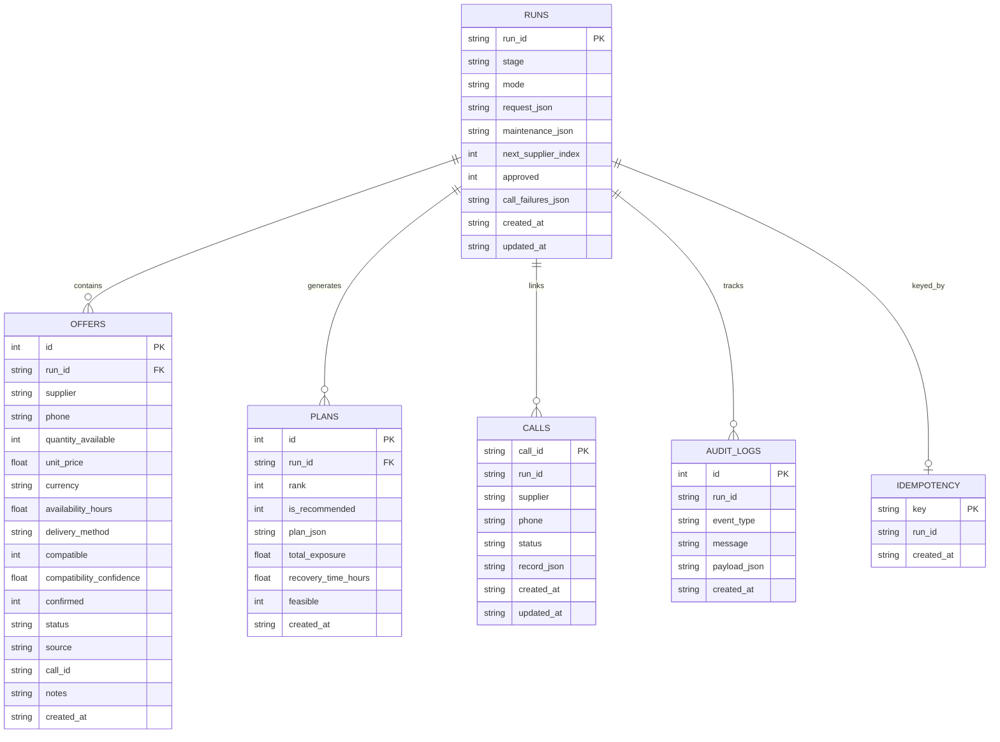

# RestartAI Database Schema & Persistence

RestartAI utilizes an embedded SQLite database configured in Write-Ahead Logging (`WAL`) mode for robust, concurrent read-write persistence across server restarts.

## Storage Location

- Default path: `data/restartai.db` (configurable via `DB_PATH` environment variable).
- Ignored in `.gitignore` to prevent committing live run data.

---

## Entity Relationship Diagram

